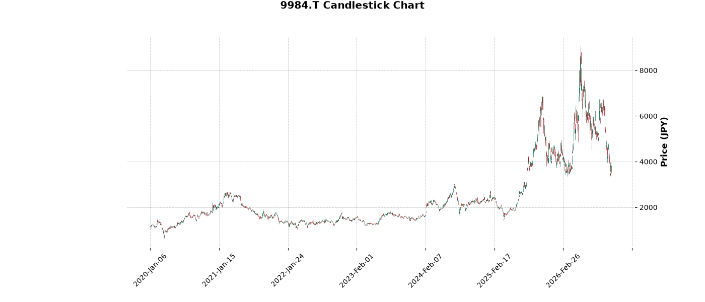
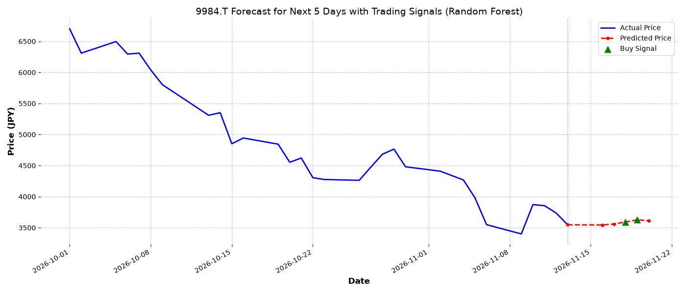
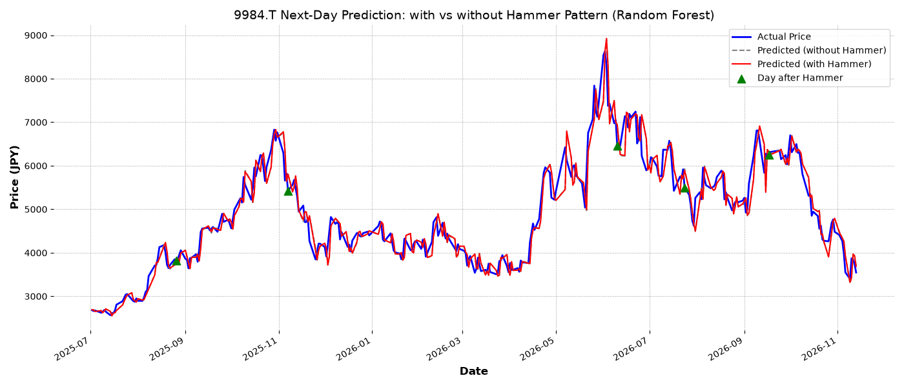

# AIを使った株価の予想（ランダムフォレスト回帰）

Yahoo Finance から株価データを取得し、scikit-learn のランダムフォレスト回帰で次の5営業日の終値を予測するプログラムです。予測値の前日比から売買シグナル（Buy / Sell / Hold）も出力します。

## 研究の目的

株価チャートには、ローソク足という形で過去の値動きが記録されています。投資家はこれを見て、「この形のあとは株価が上がりやすい」といったパターンを経験的に見つけてきました。このやり方を**テクニカル分析**といいます。

本研究では、次の3点を目的にしています。

- 株価チャートを AI に学習させ、テクニカル分析をどこまで再現できるかを検証する
- 未来の株価をどのくらい予測できるかを試す
- 人間の代わりに AI が分析を担う可能性について考察する

## 実行結果の例（ソフトバンクグループ 9984.T）

2020-01-06 ～ 2026-11-13 の株価データ（1,675日分）を使い、2026-11-14 に実行した結果です。

### ローソク足チャート



### 次の5営業日の予測と売買シグナル

直近30営業日の実績（青）に続けて、予測（赤の点線）を表示しています。▲は Buy シグナルです。



| 日付（目安） | 予測終値 | 前日比 | 売買シグナル |
|---|---:|---:|---|
| 2026-11-16 | 3,543.50円 | -0.10% | Hold |
| 2026-11-17 | 3,560.15円 | +0.47% | Hold |
| 2026-11-18 | 3,592.46円 | +0.91% | Buy |
| 2026-11-19 | 3,626.54円 | +0.95% | Buy |
| 2026-11-20 | 3,614.07円 | -0.34% | Hold |

最新の終値（2026-11-13）は 3,547.00円です。

テストデータ（全体の20%）での誤差は次のとおりです。先の日になるほど誤差が大きくなります。

| 何日先か | MAE（円） | R² | 平均誤差率 |
|---|---:|---:|---:|
| 1日先 | 206.25 | 0.9435 | 4.06% |
| 2日先 | 311.06 | 0.8756 | 6.11% |
| 3日先 | 385.48 | 0.8131 | 7.51% |
| 4日先 | 437.87 | 0.7537 | 8.58% |
| 5日先 | 485.78 | 0.6991 | 9.55% |

### ハンマーパターンの評価

テスト期間の実績（青）と、翌日の予測を重ねたグラフです。予測は「ハンマーなし」（灰色の点線）と「ハンマーあり」（赤）の2つです。▲は、下落後のハンマーが出た翌日を示します。



| モデル | MAE（円） | R² | MAE（ハンマー翌日のみ） |
|---|---:|---:|---:|
| ハンマーなし | 216.49 | 0.9409 | 266.25 |
| ハンマーあり | 216.25 | 0.9409 | 269.37 |

- ハンマー型の足は 68本ありました。そのうち5営業日の下落後に出たものは 33本で、テスト期間内は 5本でした。
- 下落後のハンマーの翌日に株価が上がった割合は 36.4% でした。
- ハンマーを入れても入れなくても、精度はほとんど変わりませんでした。この銘柄・期間では、ハンマーが翌日の予測に役立ったとはいえません。

> **注意**：R² が高く見えても、株価は前日の値に近いため、「明日も今日と同じ値」と予測するだけで似た数字になります。モデルがそうした単純な予測より優れているかどうかは、まだ検証していません。

## 実行方法（Windows）

`株価予測.bat` をダブルクリックしてください。

- Python をインストールしていない PC でも動きます。
- 同じフォルダに `python\` が無い場合は、初回だけ自動で準備します。持ち運び用の Python 3.12 と必要なライブラリをダウンロードするため、数分かかり、インターネット接続が必要です。
- ティッカーコード・開始日・終了日を聞かれます。Enter だけで既定値（`9984.T` / `2020-01-01` / 今日）を使います。「7203」のように4桁の数字だけを入力すると、東証銘柄として `.T` を付けます。

引数で指定することもできます。

```bat
株価予測.bat 7203.T 2020-01-01 2025-07-17
株価予測.bat --update   :: yfinance を最新版に更新してから実行
株価予測.bat --reset    :: python\ を作り直す
```

Python が入っている環境では、次の手順でも実行できます。

```bash
pip install -r requirements.txt
python stock_predict.py 9984.T 2020-01-01
```

## 処理の流れ

1. **データ取得**：yfinance で、指定した銘柄と期間の株価（Open / High / Low / Close）を取得します。
2. **前処理**：欠損値を前日の値で補完します（未来の値は使いません）。終値から日ごとの変化率（%）を計算します。
3. **5日間予測**：過去60営業日の変化率を入力にして、「最新の終値から1～5営業日後に何%動くか」を予測し、価格に戻します。変化率で予測するので、過去の価格帯を超える値も予測できます。ランダムフォレスト回帰（決定木100本）を使います。
   - 学習80%・テスト20%で評価します。学習データの正解がテスト期間と重ならないよう、間に4件の空きを入れます。
   - 誤差（MSE・MAE・R²・平均誤差率）は、全体のほかに「1日先～5日先」ごとにも表示します。
4. **売買シグナル**：予測値の前日比で判定します。+0.5% 以上なら Buy、-0.5% 以下なら Sell、それ以外は Hold です。1日目は最新の実際の終値と比べます。
5. **ハンマーパターン分析（評価用）**：下ヒゲが実体の2倍以上で、上ヒゲが実体より短いローソク足のうち、直前5営業日で下落していたときのものをハンマーとして検出します。過去10営業日の変化率で翌日の変化率を予測するモデルを、「ハンマーなし」と「ハンマーあり」の2つ作り、MAE・R² を比べます。ハンマーの翌日だけの誤差と、ハンマーの翌日に上昇した割合も表示します。

## 出力（`出力結果\` フォルダ）

| ファイル | 内容 |
|---|---|
| `{ticker}_candlestick_chart.png` | ローソク足チャート |
| `{ticker}_stock_prediction.png` | 直近30営業日の実績と、次の5日間の予測・売買シグナル |
| `{ticker}_prediction_result.json` | 最新の終値、予測日、予測値、前日比、売買シグナル |
| `{ticker}_hammer_pattern_stock_prediction.png` | テスト期間の実績と、ハンマーなし／ありの翌日予測の比較 |

## 研究発表時の結果と、その後の改良

### 発表時の結果（改良前のプログラム）

発表時のプログラムで予想した値と、実際の株価を比べました。

| 証券コード | 予想値 | 実際 | 誤差率 |
|---|---:|---:|---:|
| 3983 | 2,579.554 | 2,673 | 3.496% |
| 3543 | 2,760.192 | 3,150 | 12.375% |
| 6146 | 44,164.89 | 48,810 | 9.517% |

誤差は平均 8.46% でした。ある程度は予想できていますが、実用的なレベルではないことが分かりました。

### 発表後に改良した点

| 項目 | 発表時 | 現在 |
|---|---|---|
| 予測する値 | 終値そのもの | 最新の終値からの変化率（過去の価格帯を超えても予測できる） |
| 前処理 | 終値を MinMaxScaler で正規化 | 正規化なし（ランダムフォレストには不要で、テスト期間の情報が混ざる原因になるため） |
| 学習とテストの分け方 | 80% / 20% で分割 | 間に4件の空きを入れ、学習の正解とテスト期間が重ならないようにした |
| 誤差の表示 | 5日分をまとめて1つ | 1日先～5日先ごとにも表示 |
| 売買シグナル | 50円以上の下落で Buy、上昇で Sell | 前日比 +0.5% 以上で Buy、-0.5% 以下で Sell（銘柄の価格帯に左右されない） |
| 予測グラフ | 直近5日の実績と予測5日を同じ横軸に重ねる | 日付の横軸で、実績から予測へつなげて表示 |
| ハンマー分析 | 終値＋ハンマーで翌日の終値を予測 | 下落後のハンマーに限定し、「ハンマーなし」と比べて効果を確認 |

## 今後の予定

- 予測に使う指標を増やす
- ニュースなどの数値以外のデータから、株価の変動を予想できるようにする
- 予測結果を簡単に確認できるよう、Web で実行できるアプリケーションを作る
- 「明日も今日と同じ値」とする単純な予測と比べて、モデルの実力を検証する

## ファイル構成

```
株価予測.bat        起動用（必要なら実行環境を自動セットアップ）
stock_predict.py    プログラム本体
requirements.txt    使用ライブラリ
docs\images\        README 用の結果画像
python\             実行環境（自動生成・Git 管理外）
出力結果\            実行結果（自動生成・Git 管理外）
```

## 使用技術

Python 3.12 / yfinance / pandas / numpy / scikit-learn / matplotlib / mplfinance

## 参考にした資料

- 株価予測モデルを構築してみよう！ #Python - Qiita
- 株価予想AIの作り方 概要編 - 得屋（FP2級 × AIエンジニアのブログ）
- chatGPT（生成AI）による株価予測 〜ファンダメンタルズ、テクニカル分析を考慮した短期的な騰落確率〜 - トレ株

> 予測結果は学習・研究用であり、投資判断を保証するものではありません。
